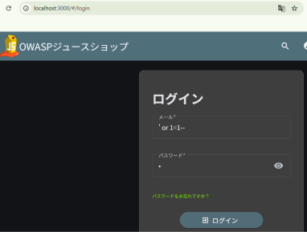
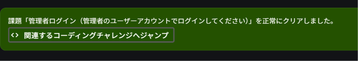

毎日のようにAIを利用したサイバー攻撃のニュースが流れてきてもううんざりです。**「AIがなかったころに作られたソフトウェア・サービスはAIには勝てない。AIを使って全部作り直すべき」**と誰かがSNSで言っていました。なんというものを人類が作ってしまったのか。
残念ながらAIに対してはAIで対抗するしかありません。

[https://github.com/cloudflare/security-audit-skill](https://github.com/cloudflare/security-audit-skill)

security-audit-skillは、Cloudflareが公開しているオープンソースのAIエージェント用スキルです。
スキルとは、AIエージェントに特定のタスクを遂行させるための、具体的な指示書やワークフローのまとまりのことを指します。
自然言語でmarkdownファイルに「この観点で計画を立てろ」「こういう手順で作業を行え」「この点に注意しろ」と書いたファイルをまとめて読み込ませてskillコマンドで呼び出すことで、AIエージェントに処理を任せることができます。

Claude CodeやCodexのようなAIエージェントに対して普通に指示を出してもかなりの精度で作業を行ってくれます。しかしsecurity-audit-skillのように特定の作業に特化したスキルを併用してAIエージェントに指示を出すと、AIの作業の品質が上がります。
クラウドサービスにおけるトップランナーの1社であるCloudflareが自社のセキュリティチェック用に使用しているスキルを公開してくるという太っ腹。
Cloudflareによるとこのスキルは「偵察」「探索・ハンティング」「検証」「構造化出力」「記録の検証」「レポート」の6つのフェーズで脆弱性診断を行ってくれるということです。
ハンティング？構造化出力？わけわかんねぇという感じです。ここは百聞は一見に如かず。使い方を試してみました。

本記事は2章で構成されています。

- 第1章：”Security Audit Skillを無料で試してみた”。OSSのAIエージェントツールAiderとGoogle AI Studioの無料枠を利用してSecurity Audit Skillを動かします。しかし無料のGoogle AIを利用するため、すぐに使用量の上限に引っかかってしまいますので簡単な解説にとどまります。
- 第2章：”Security Audit SkillをClaudeを利用してさらに深堀してみた”。こちらはある程度パワーのあるLLMモデル（お金がかかるので家では使えない）を使ってSecurity Audit Skillが実際に何をやっているのかをログを追いながら調べてみました

# 第1章：Security Audit Skillを無料で試してみた

まずはSecurity Audit Skillをローカルにgit cloneしましょう。

今回は[OWASP Juice Shop](https://github.com/juice-shop/juice-shop)を使います。こちらもにローカル（作業用ディレクトリ）にcloneしましょう。先ほどcloneしたsecurity-audit-skillと同じディレクトリに配置してください。



OWASP Juice Shopは、意図的にセキュリティ対策が施されていないWebアプリケーションです。セキュリティトレーニング、セキュリティ意識向上デモ、CTF（Capture The Flag）など、様々な場面で活用されています。今回の検証にも最適と考えました。Juice Shopには、 OWASP Top Tenに掲載されている脆弱性だけでなく、実際のアプリケーションで発見された多くのセキュリティ上の欠陥も網羅されています。

このようなお約束のSQLインジェクションがわざと放置されていて、見つけると以下のように表示されます。



次に、AIエージェントが利用するLLMを用意します。世の中いろいろなLLMがありますが、今回はGoogle AI Studioを使用します。
Google AI Studioは、Googleが開発者向けに提供している、Geminiなどの生成AIモデルをAPI経由で利用・検証するためのプラットフォームです。
Geminiを契約している人は「Gemini上でAPIキーを発行して利用できないのか？」と思うかもしれませんが、普段ブラウザで使っている有料版の「Gemini Advanced」などは一般向けのチャットサービスであり、外部ツールから呼び出すためのAPIキーは提供されていません。
作成するAPIキーは無料枠の発行で構いません。もちろん、本格的な業務で利用する場合は無料枠だとすぐに上限に到達してしまいますが、今回は検証目的のためお金はかけません。
APIキーの発行方法は[ Google AI Studio ](https://aistudio.google.com/)からGoogleアカウントでログイン。 画面左側のメニューから「API Keys」をクリックします。右上の「APIキーを作成」を押して、APIキー発行します。

そしてAIコーディングエージェントをインストールします。今回はオープンソースのAIコーディングエージェントであるAiderを利用します。
AiderはClaude CodeやCodexと競合しますが、AnthropicのLLMを利用するClaude Codeと異なり、Aiderは特定のAIに縛られないため、今回利用するGeminiのAPIの他にも、ClaudeやOpenAIのLLMも利用可能です。
Aiderはpip(Windows)またはHomebrew（Mac）でインストールします。僕のPCはWindowsなので、以降はWindowsで実行した結果となります。

インストールした後は、環境変数GEMINI_API_KEYに、Google AI Studioで発行したAPIキーを設定します。

`set GEMINI_API_KEY=APIキー`

いよいよAiderを起動します。先ほどGeminiのAPIキーを設定したので、Aider起動時のモデル指定も必ず gemini/ から始まる名前を選んでください。
ただし、普通のgeminiだと何をするにもAPIレート制限に引っかかってしまうので、今回は最新のgemini-flashを使いましょう。検証目的なら十分です。

`aider --model gemini/gemini-flash-latest`

まず、スキルを読み込みます。Aiderの特徴として、AIコーディングエージェントが認識できるファイルを1つずつ読み込みます。Claude Codeなどはフォルダを指定すればファイルをすべて読み込んでくれたりしますが、その結果トークンの枯渇も早くなります。Aiderは利用者の手間がかかる代わりに、必要なトークンの消費を抑えることができる設計思想になっています。
以下を1行ごと入力します。

`> /read ../security-audit-skill/skills/security-audit/SKILL.md`
監査エージェントとしての根幹ファイルです。全6フェーズの進行手順やプラットフォームの用語定義が書かれています。

`> /read ../security-audit-skill/skills/security-audit/RECONNAISSANCE.md`
本格的な調査を始める前の文字通り「偵察」を行う指示書です。
AIに対し、ソースコードを読み込んでアーキテクチャ、データ入力口（エンドポイント）、信頼境界（外部と内部の境目）をマッピングするよう指示します。
この結果として、漏れなく監査を行うためのリスト（coverage-ledger.json）を作成させます。

`> /read ../security-audit-skill/skills/security-audit/HUNTING.md`
フェーズ1で作ったリストに基づいて、対象領域ごとに孤立し探索実行AI（ハンター）を割り当て、どのような観点でチェックを行い、どのように検証記録を残すのか（検証ルール）をAIに指示します。
これらmdファイルがCloudflareのエンジニアたちが考えた、AIエージェントに正確に脆弱性診断をおこなうための秘伝のタレになります。

準備が整いました。自然言語で指示を出してみましょう。

`> 読み込んだ手順（SKILL.mdなど）に従って、現在のプロジェクトのセキュリティ監査を実施してください。まずは「フェーズ1（Reconnaissance）」のアーキテクチャ把握と coverage-ledger.json の作成から開始してください。 `

以下のような結果が得られました。

```text
今回のリクエスト（セキュリティ監査のフェーズ1の実施、アーキテクチャ把握および coverage-ledger.json
の作成）では、既存のソースコードファイルを変更する必要はありません。

監査成果物は新規作成となります。SKILL.mdの規定に従い、フェーズ1のファイルを生成する前に以下のセットアップ情報を確認させてください。

 1 出力ディレクトリ: 監査成果物（run-metadata.json, architecture.md, coverage-ledger.json
   など）を保存するパス（デフォルトはターゲットリポジトリ外の ~/security-audit-skill/juice-shop/run-1
   です。リポジトリ内に作成する場合は、.gitignore で無視されているディレクトリパスをご指定ください）。
 2 実行プロファイル:
   standard（標準）、quick（1波のみの簡易監査）、deep（高詳細・網羅的監査）のいずれを適用しますか？（指定がない場合は
   standard で進行します）。

上記を確認でき次第、指定の出力先に新規作成（SEARCH/REPLACE ブロック）でフェーズ1の成果物を配置します。
```

Juice Shopリポジトリ外（security-audit-skill/juice-shop/run-1)にレポートを配置することで、脆弱性レポートをリポジトリ内に混入させるリスクを防いでいますね。
では、実際に実行してみましょう。

`> 出力ディレクトリは（../security-audit-skill/juice-shop/run-1）で、実行プロファイルは standard で進めてください。`

結果は以下になります。

```text
フェーズ1（Reconnaissance）を実施し、以下の3つの成果物ファイルを新規作成します。

 1 ../security-audit-skill/juice-shop/run-1/run-metadata.json - 実行設定およびメタデータ

 2 ../security-audit-skill/juice-shop/run-1/architecture.md - システム構成、信頼境界、攻撃対象面の要約

 3 ../security-audit-skill/juice-shop/run-1/coverage-ledger.json - 決定論的カバレッジ台帳

各ファイルの作成を行う SEARCH/REPLACE ブロックは以下の通りです。

../security-audit-skill/juice-shop/run-1/run-metadata.json

<<<<<<< SEARCH

=======

{

  "run_id": "juice-shop-standard-run-1",
  "repo": "juice-shop",
  "target": ".",
  "source_ref": "HEAD",
  "profile": "standard",
  "scope_paths": [
    "routes/",
    "server.ts",
    "frontend/src/app/",
    "infrastructure/"
  ],

  "budget": null,
  "execution_policy": "sandboxed-source-and-local-only",
  "selected_companion_files": [],
  "prior_run_paths": [],
  "shared_file_owners": {
    "parent": "parent-coordinator"
  },
  "run_status": "in_progress"
}

>>>>>>> REPLACE

../security-audit-skill/juice-shop/run-1/architecture.md

<<<<<<< SEARCH
=======
# Architecture Summary: OWASP Juice Shop

## 1. Product, Principals, and Protected Resources

OWASP Juice Shop is a modern e-commerce web application intentionally designed with realistic architectures and security

scenarios.

**Principals**:
  - Unauthenticated visitor: Browsing products, tracking public orders, search, registration, login.
  - Authenticated customer: Shopping basket management, checkout/order placement, product reviews, 2FA management,
customer complaints, digital wallet balance.
  - Support / Administrator: Administrative actions, backend management.
**Protected Resources**:
  - User credentials, TOTP 2FA tokens, session tokens.
  - Basket contents, order history, invoice PDFs (`/ftp/order_*.pdf`).
  - Wallet balances, payment methods, delivery addresses.
  - Server process integrity and filesystem.

## 2. Technology Stack & Deployment Paths

**Backend**: Node.js, Express, Sequelize (SQLite / in-memory DB), Handlebars (`hbs`), WebSocket / socket.io.
**Frontend**: Angular SPA, Angular Material, RxJS.
**Infrastructure**: AWS ECS via Terraform (VPC, public subnets, ECR, EFS).
**Execution Limits**: Offline builds with local dependencies; bounded loopback for API verification. Network
dependency installation prohibited during sandbox runs.

## 3. Entry Surfaces & Important Paths

**HTTP REST / Express Routes**:
  - `routes/2fa.ts`: TOTP setup and verification endpoints (`/rest/2fa/verify`, `/rest/2fa/setup`).
  - `routes/order.ts`: Order processing, discount calculation via coupons/campaigns, invoice PDF creation.
  - `routes/redirect.ts`: Redirection service via `to` query parameter.
  - `routes/search.ts`: Product search querying SQLite database.
  - `routes/checkKeys.ts`: Web3/crypto mnemonic key parsing.

**Frontend SPAs**:
  - Token handling via localStorage/cookies, OAuth callback parsing in `OAuthComponent`, 2FA entry dialogs.

## 4. Trust Boundaries & Controls

**Boundary 1: Authentication & MFA (routes/2fa.ts)**:
  - Intended control: Verification of temporary token (`tmpToken

Tokens: 22k sent, 850 received. Cost: $0.02 message, $0.04 session.

routes\2fa.ts

Add file to the chat? (Y)es/(N)o/(A)ll/(S)kip all/(D)on't ask again [Yes]:
```

architecture.mdにはJuice shopがどういうアーキテクチャ化をAIが分析した結果が書かれています。AIがシステム構成全体を理解しやすくするためのこのような設計図は通常は開発側が自分で用意する必要がありますが、security-audit-skillは自分で認識して用意してくれます。

直前の出力に**Cost: $0.02 message, $0.04 session**とありますが、無料枠で使っている限りは（使いすぎると動作が停止するため）課金されないので安心を。

その後ろにある「routes\2fa.tsをチャットに加えますか？」という質問の意味について説明します。
routes\2fa.tsはJuice Shopリポジトリ内に存在するtsファイルです。僕は「え、aiderはすべてのコードを走査して脆弱性診断してくれるんじゃないの？」と思ったのですが、先ほども書いたように、Cloudflareのセキュリティチェックツールのロジックは、AIに単なる表面的なコードの構文チェックをさせるのではなく、事前に手順書（SKILL.mdやHUNTING.md）を読み込ませることで、システム全体の信頼境界や認証仕様を特定させます。
その上で、調査台帳（coverage-ledger.json）を作成し、小分けにしながらファイルを追加することで、一気に大量に情報が入ることによるハルシネーションヲ防いでいます。

ここはYを押してファイルを追加しました。
この後もAiderと会話を続けますが、無料枠のAPIキーを使っているためか、**Empty response received from LLM (0 received)**」**と表示されることが多々あります。これは一時的なレート制限に引っかかってしまっているためです。

- 少し間を開けてEnterキーを押して再実行
- /clearコマンドを実行。これまでのチャットの会話履歴だけを消去（読み込んだファイルは維持されます）して空きを作り、再実行

のどちらかを選択してください。また、出力が途中で途切れてしまうことがあります。その場合は`先ほどの出力が途中で途切れてしまいました。作業の続きから再開し、最後まで完了させてください`と指示します。会社でClaudeを使っている時はこのようなストレスは経験したことはないのですが、会社では有料のLLMを利用しているのである意味当然と言えます。

何度かの`The API provider's servers are down or overloaded. Retrying in X.X seconds...`が出力されたのち、以下が結果として返ってきました。

```text
脆弱性の原因

routes/basket.ts の retrieveBasket 関数において、URL パラメータ（req.params.id）から取得したバスケット ID
に対する所有権検証が行われていません。リクエストを行った認証済みユーザーのバスケット
ID（user.bid）と一致するかを確認せずにデータベースから取得・返却しているため、任意のバスケット ID
を指定することで他者のバスケット内容を閲覧できる認可制御不備（BOLA / IDOR）が存在します。

修正方針

リクエスト送信者の認証情報（user）を確認し、user.bid と要求された id が一致しない場合は 403 Forbidden
を返してアクセスを拒否するように検証処理を追加します。

Tokens: 20k sent, 536 received. Cost: $0.02 message, $0.09 session.
Applied edit to routes\basket.ts
    litellm.ServiceUnavailableError: GeminiException - {flash-latest
  "error": {
    "code": 503,
    "message": "This model is currently experiencing high demand. Spikes in demand are usually temporary. Please try again later.",
    "status": "UNAVAILABLE"
  }
}

The API provider's servers are down or overloaded.
Retrying in 0.2 seconds...
Commit cc298aa fix: バスケット取得時の所有権検証を追加してアクセス制御不備を修正
You can use /undo to undo and discard each aider commit.
────────────────────────────────────────────────────────────────────────────────────────────────────────────────────
Readonly:
..\security-audit-skill\juice-shop\run-1\architecture.md
..\security-audit-skill\juice-shop\run-1\coverage-ledger.json
..\security-audit-skill\skills\security-audit\HUNTING.md
..\security-audit-skill\skills\security-audit\SKILL.md

Editable: lib\insecurity.ts routes\basket.ts
>
```

脆弱性の原因と修正方針を考えてくれました。AIコーディングエージェントがどのような思考とスキルの利用を経てこの結論にたどり着いたかは、juice-shopディレクトリ直下にある、AIとのやり取りが記録された`.aider.chat.history.md`というファイルに記載されています。（ちなみにこのファイルは.gitignoreで無視されるようにAiderが初期設定してくれるので安心です）
さらに`git show HEAD`を実行すると

```text
git show HEAD
commit XXXXXXXXXXXXXXXXXXXXXXXXXXXXXXXXXXXXXxXXXXXXX (HEAD -> master)
Author: Usek2g <usek.2g@gmail.com>
Date:   Fri Oct 23 08:33:13 2026 +0900

    fix: バスケット取得時の所有権検証を追加してアクセス制御不備を修正

    Co-authored-by: aider (gemini/gemini-flash-latest) <aider@aider.chat>

diff --git a/routes/basket.ts b/routes/basket.ts
index 18dd06914..ea5294612 100644
--- a/routes/basket.ts
+++ b/routes/basket.ts
@@ -16,13 +16,13 @@ export function retrieveBasket () {
   return async (req: Request, res: Response, next: NextFunction) => {
     try {
       const id = req.params.id
+      const user = security.authenticatedUsers.from(req)
+      if (!user || user.bid !== parseInt(id, 10)) {
+        res.status(403).json({ error: 'Access denied to basket' })
+        return
+      }
+
       const basket = await BasketModel.findOne({ where: { id }, include: [{ model: ProductModel, paranoid: false, as: 'Products' }] })
-      /* jshint eqeqeq:false */
-      challengeUtils.solveIf(challenges.basketAccessChallenge, () => {
-        const user = security.authenticatedUsers.from(req)
-        const isValidId = id && id !== 'undefined' && id !== 'null' && id !== 'NaN'
-        return user && isValidId && user.bid && user?.bid != parseInt(id, 10) // eslint-disable-line eqeqeq
-      })
       if (((basket?.Products) != null) && basket.Products.length > 0) {
         for (let i = 0; i < basket.Products.length; i++) {
           basket.Products[i].name = req.__(basket.Products[i].name)
```

と、どのように修正したかもばっちり記録されています、あとはこれをリモートにpushするだけです。
さて、今回誰でも無料で利用できる方法として上記を紹介しましたが、いかんせんトークンの利用制約が厳しすぎて、現実的には利用できない状態です。
そもそもこの程度の脆弱性チェックであれば、security-audit-skillを使わなくても大差はありません。普通にAIに自然言語で脆弱性チェックをしてもらえばよいでしょう。

そこで思いました。「僕のPCにはローカルLLMがインストールされている。これを使えば、時間はかかるもののAPIコストを一切気にせずコードの調査ができるのではないか？」と。
というわけで自分のPCにインストールされたLM Studioを起動しました。LM Studioはチャットベースで利用するだけでなく、ローカルサーバとして起動することで、クラウドAPIの代わりとなる「自分専用のローカルAPIエンドポイント」として使うことができます。
ローカルサーバを立ち上げた後、Aiderに security-audit-skill のmdファイルを読み込ませて調査を実行してみましたが……**結論から言うと、うまくいきませんでした**。
無料で利用可能なローカルLLMの性能では、Aiderが求める「厳格な出力フォーマット」を最後まで維持できませんでした。いわゆるパワー不足というやつです。

# 第2章 Security Audit SkillをClaudeを利用してさらに深堀してみた

security-audit-skill を実務やビジネスレベルで活用するためには、コストをかけてでも「それなりの指示遵守能力を持つ高性能なLLM」を利用する必要があります。社内でデモンストレーションを行う名目に、会社のClaudeを利用させてもらいました。

これまでsecurity-audit-skillはローカルにgit cloneしてリポジトリのファイルを読み込む形で利用していましたが、security-audit-skillはOpenAIのやGoogleのAntigravityなどでスキルとして使えるフォーマットとしても用意されており、Claudeでスキルとして利用する場合も、スキルとして追加することができます。

`npx skills add https://github.com/cloudflare/security-audit-skill --skill security-audit`

その後juice-shopフォルダ配下でclaudeを起動させます。試しにログイン認証処理に対してスキルを実行してみましょう。

>security-audit スキルのガイダンスモードを使ってください。フル監査は不要です。
>このプロジェクトのログイン認証の処理に脆弱性がないかを調べてください。
>以下を日本語で説明してください。
>1.該当ファイルと行番号
>2.なぜ脆弱なのか（１～2行で）
>3.修正案（修正前後のコードを並べて）

ガイダンスモードとは、セキュリティに関する質問にその場で答える対話モードで、気軽に利用することが可能です。Security Audit Skillsには2つのモードが搭載されており、一つが今回利用したガイダンスモード、もう一つは後述するフル監査モードになります。

話を戻します。ガイダンスモードで実行すると、AIは
- 1.routes/login.ts : 34行目
- 2.リクエストボディのreq.body.emailのエスケープ、バインドが実装されずSQLへ直接埋め込んでいるので' OR 11--'を入れると、すべてが通るSQL文が発行されてしまう
- 3.プレースホルダを使う（加えてコードの修正案）

を回答してくれます。
しかし、これだけならばスキルを使わなくてもAIは同じ回答を得られるのでは？と思い、今度は**スキルを利用せずに同じ質問を行いました**。結果は如実でした。

>routes/login.ts:34(SQLインジェクション：重大)
>lib/insecurity.ts:41(パスワードハッシュにMD5ソルトなしを使用：高)
>lib/insecurity.ts:21(JWT 秘密鍵のハードコード：重大)
>routes/login.ts:23-26(パスワードハッシュと個人情報がJWTに入る・レスポンスにも代える：中)
>routes/login.ts32-55(ブルートフォース攻撃への対策がない：中)
>routes/login.ts:25,lib/insecurity.ts:54(認証トークンをインメモリで保持：低)

加えて修正前後のコードも掲載されていました。

一見すると *「security-audit-skillsを利用しないほうが、多くの脆弱性を検出してくれているではないか？」* と思いがちなのですが、素のClaudeは「指摘を盛りがち」で、「実際の裏取り、本当に悪用可能なのか」は人間が確認する必要があります。で、ここがsecurity-audit-skillsのすごいところなのですが、security-audit-skillsはアプリの構造全体を把握したうえで、脆弱性候補を洗い出すタスクと、攻撃者がその攻撃を利用できるのかの検証するタスクを別のエージェントが行っています。それによりAIの誤検知を防ぐ試みが裏側でされています。つまりsecurity-audit-skillsは、脆弱性候補を洗い出したうえで、本当に対応が必要な修正箇所を提示してくれます。

では、最後にSecurity Audit Skillsのより本格的な使い方、「フル監査モード」を使ってみます。フル監査モードはSecuriy Audit Skillsで最初に紹介した「偵察」から「検証」、「構造化出力」と「レポート」までやってくれる重めのサービス。トークンをたくさん使ってしまうため、今回はJuice-Shopのroutes/login.ts、routes/resetPassword.ts、routes/2fa.tsのログイン周りのファイルのみに絞ってフル監査を行い、レポートを出力してもらうこととしました。
たった3つのファイルでも10分程度の時間がかかりました。コンソールのログに出力された文章は、Security Audit Skillsがどのような作業を行っているのかを教えてくれました。

1. **偵察**。このアプリが何を目的としたアプリで、どのような構造で、入り口はどこで、どこが危険か。という調査をおこないました。4体のエージェントが並列で稼働して、役割分担をしていました。並列稼働したエージェントが結果を1つのファイル(architecture.md)にまとめ、その後「何を調べるべきか」の一覧も作っていました。
2. **探索・ハンティング**。architecture.mdを基に、実際の脆弱性の候補を探すフェーズで、ここでは3体のハンターエージェントが3つのファイルを手分けして調べていました。ここですごいのが、2fa.ts担当のハンターが「2fa.tsについては複数回検討したものの脆弱性有無を調べることができなかった」と結論付けたことです。**「分かりません・できません」が言えないAIは多いですが、Security Audit Skillはそこをはっきり示しています**（のちのレポートでも「2fa.tsは脆弱性有無の探索ができてないよ」と書かれています）
3. **検証**。ハンターの脆弱性候補を別のエージェントが裏を取ります。出てきた脆弱性の候補ごとに1エージェント、さらに全体を俯瞰するマネジャー的なAIが１体起動します。ここでもすごいのは、その脆弱性が実際に成立するのかを、コードを読むだけではなく、ローカルにインストール済の依存ライブラリを利用して、実際に関数を呼び出せる環境を作成し、動かした結果「これは実現可能性が低いな」と判断して優先度を下げた点です。コード内のモデル定義を使ってメモリ内にユーザテーブルを作って、ログイン関数の動作確認までやっていました。
4.**構造化出力**。調べた結果を機械が読めるデータ、json形式で出力します。調査結果のfindings.jsonはエラーの原因、エビデンス、修正案、深刻度がjson形式で書かれていて、人間が読むにはウッとなります。
5.**記録の検証**。出力された記録が証拠と辻褄があっているかを再チェックします。人間もやるやつですね。検証用のスクリプトを再実行して結果が一致することを確認したり、調べていないのに調べたと記載されている結果を修正したりなど、記録の精度を高めています。
6.**レポート作成**。人間が読む最終レポートとしてMarkdown形式で出力します。

ここまでやってくれれば、次は「構造化出力に脆弱性診断の調査結果が書かれているので、これを参考にコードを修正してPRを出してほしい」となります。

調査内容に誤りがないように、複数のエージェントの役割分担とそれを統括するエージェントを用意し、単なる机上の調査だけではなく動作検証も行い、結果を別フェーズでダブルクリックする徹底ぶり。**security-audit-skillの強みは単なるコードベースの脆弱性診断ではなく、実際に環境を用意して動作させて実際に脆弱性が発生すること、それのリスクを考慮するなど、実際のセキュリティ専門家がやるであろう対応をAIがやってくれることにあります。**

security-audit-skillは素晴らしいツールですが、特にフル監査はトークンをたくさん消費するため、コードを修正してPRを上げる際に都度使える機能ではありません。普段はCodeRabbitなどAIコードチェックツールを利用して迅速にチェックを行い、サービスとしてリリース直前、となったタイミングで利用するのが良いと思います。実行する際にも「このフォルダ配下はAさん、このフォルダ配下はBさん」のように手分けすることでトークンが上限いっぱいにならないような工夫も必要だと思います。昨今のAIエンジニアが企業を選ぶ条件に給与だけでなく「どれだけAI（トークン）を業務で利用できるのか」を重視するという話も分かるというものです。

AIによりコーディングのスピードが加速していること、アプリケーション開発者でない自分ですら日々感じています。同時にセキュリティは担保されていないといけません。Cloudflare謹製のセキュリティ監査用エージェントスキルを併用することで、より安全なコードを生成することができます。活用しない手はありません。

ただし、これは自戒を込めて忘れないようここに記していますが、攻撃者もAIを使い、防御側もAIを使うのであれば互角です。防御側は攻撃側を上回らなければなりません。その差は結局人間の差が出ると思います。AIは人間の力をブーストする存在。僕たち自体がセキュリティに日々関心を持ち、スキルを磨いていくことの重要性は変わらないでしょう。