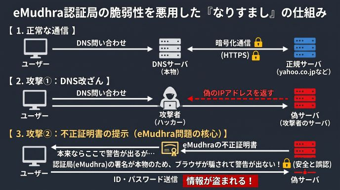

[ブラック・オクトーバー](https://ja.wikipedia.org/wiki/%E3%83%96%E3%83%A9%E3%83%83%E3%82%AF%E3%83%BB%E3%82%AA%E3%82%AF%E3%83%88%E3%83%BC%E3%83%90%E3%83%BC)
2026年10月はあとから振り返っても、セキュリティの界隈にとって、世界的にも特異な1か月だったと言われるのではないでしょうか。このようにWikipediaにも記されています。

世はまさに大漏洩時代eMudhra（イームドラ）の脆弱性は先月記事には書きませんでしたが、会社ではこれも対応しました。一般従業員に向けてはOSのアップグレードを待つこと。アプリケーション開発者向けには利用しているライブラリが証明局情報を修正したライブラリや、それをインストールしているコンテナイメージ・OSを利用するよう指示しました。

本脆弱性は一般的なソフトウェア脆弱性と背景が少し異なるため、どのような問題があるのかイメージしにくい人もいると思います。ここで改めて解説します。
まず「認証局」とは、インターネットの通信を行う相手（サーバ）が、なりすましではない正当な相手であることを証明する機関です。私たちがサイトを公開する際、自分のサイトのドメインが設定されているサーバが正当なことを証明するため、認証局に対して「SSL証明書」を発行するよう申請します。

サーバ上でopensslコマンドを実行すると、秘密鍵と公開鍵のセットが作られます。この公開鍵を含んだCSR（Certificate Signing Request：証明書署名要求）というファイルを認証局側に送ります。
昔SSL証明書の発行が有料だったころは、認証局（セコムトラストとか）のサービス画面からCSRファイルをアップロードしたりしていましたが、無料のSSL証明書「Let's Encrypt」が登場してからは、コマンドを叩くだけでCSRファイルが送付できるようになりました。Let's Encrypt側のドメイン所有確認も、Webサーバにインストールした専用アプリ（Certbot）がWebサーバの特定ディレクトリに一時ファイルを自動配置し、それをLet's Encryptが読み取ることで人手を介さず完了するため、手間と時間が大幅に改善されました。最近はAWSの証明書発行サービスACMを使っていますが、こちらは証明書作成ボタンを押せば、「認証用にあなたのドメインのDNSにこの設定を追加して」と指定されたTXTレコードの値を設定するところまでやってくれるので、認証もスムーズです。

これらの審査に合格した結果得られるのがSSL証明書です。認証局の管理画面からダウンロードしたファイルをWebサーバの指定ディレクトリに配置します。Let's Encryptの場合は、サーバにインストールしたアプリが自動で配置してくれます。ACMの場合は、ALBやCloudFrontにSSL証明書を配置・適用するところまでAWSが行ってくれます。どんどん楽になっていきますが、裏側でどういう仕組みになっているのかを忘れてしまいますね（これはクラウド全般に言えることですが）

では、このSSL証明書がどう利用されるのか。ブラウザがサーバにアクセスする際、サーバ側はSSL証明書（サーバの公開鍵＋認証局の署名）を返信します。ブラウザは内部にあらかじめ「認証局の公開鍵」を持っています。この「認証局の公開鍵」を使ってSSL証明書の署名を復号・検証することで、認証局が署名したドメインと公開鍵が一致していること（＝正しく認証されたこと）を確認し、安全性を担保します。

では、今回のeMudhraの問題は何だったのか。それは、「eMudhraの本物の秘密鍵で署名された任意のドメインのSSL証明書を、誰でも勝手に発行できてしまう状態」だったという点です。秘密鍵を作るスクリプトに欠陥があり、本来384ビットのランダムな数値になるべき秘密鍵が、8ビット（1バイト）」に切り詰められて生成されてしまいました。こうなると総当たり式でブラウザ側の公開鍵とマッチする秘密鍵を作ることができてしまいます。

攻撃者が仮にパケットを改ざんして、「yahoo.co.jp」というドメインを自分のサーバのIPアドレスに向けるよう通信を改ざんしたとします。しかし通常であれば、正規のSSL証明書は取得できないため、ブラウザには「このサイトは安全ではありません（ドメインをなりすましています）」と警告画面が出ます。しかし攻撃者のサーバに「不正発行されたeMudhraのSSL証明書（本物の署名入り）」が配置されていた場合、ブラウザ側は「信頼されたeMudhra認証局のSSL証明書で署名されているな」と騙されてしまい、警告なしにアクセスを確立してしまいます。
その結果、正当なサイトと誤認してフィッシング詐欺に遭うだけでなく、攻撃者のサーバとの間で暗号化通信が成立してしまうため、入力したIDやパスワードは攻撃者に平文のまま読み取られ、完全に盗まれてしまいます。

最初に書いたように、通信が改ざんされないと成立しない脆弱性だったため、成立条件は限定的であるもののの、あらゆるサイトに対してなりすましサーバを用意できる凶悪な脆弱性でした。OS提供ベンダー、ブラウザ提供会社だけでなく、PythonなどSSL証明書を内包するプログラム言語を提供する組織もバージョンアップ作業を行うこととなりました。eMudhraは今回のインシデントと、それに伴う大手テクノロジー企業からの信頼喪失を受けて、グローバルSSL/TLS証明書事業から撤退すると発表しました。

[相次ぐ不正アクセスの攻撃元の多くがAIであることを確認](https://gmo-cybersecurity.com/blog/20261019/)

残念ながら今話題になっているGMOサイバーセキュリティイライエ。今回のPHP2Shellで確かな存在感を示したセキュリティの専門家集団です。タイトルがこう書いてありますが、もうこの業界の人は100％AIによって攻撃のスピードと正確性が向上したと確信しているでしょう。ほんととんでもないものを生み出してしまったものです。

2026年9月下旬から10月上旬にかけ、韓国の複数の金融機関でデータ侵害が発生しました。中国産のオープンソースペネトレーションテスト用ツールARTEXをAIに利用させ、特定のサイトの脆弱性を突き、攻撃を仕掛けるという方法です。ツールは使う人間の手により凶器にも盾にもなるという例ですね。これと同じことが10月から日本でも立て続けに発生しているということです。今日この記事を書いている11/4にも、無印良品のWebサイトに不正アクセスがあり、クレジットカード情報が漏洩したとのことです。もう、漏洩していないデータはないのでは・・・。
なお、オープンソースソフトウェアの開発者が中国のエンジニアであることと、そのソフトウェアを使って誰が攻撃をしているのかは一切関連がありません。

- [AIペネトレーションテスト基盤「Cairn」の公開パネルから見えた攻撃活動についてまとめてみた](https://piyolog.hatenadiary.jp/entry/2026/10/20/205855)

その名の通りAIがペネトレーションテストを行ってくれる基盤ですが、管理画面に認証不要でログインできる状態になっているサイトがあったようです。そこを攻撃者に浸かれ、悪用されたとの報告です。Shodanを使えば、ログイン認証がかかっていない管理画面を見つけることもできるということですね。管理画面には攻撃者がCairnをどう利用して、ターゲットの企業に攻撃を仕掛けたのかの痕跡も残っていたとのこと。

- [ISUCON2026 で優勝しました（当日編）](https://zenn.dev/luvtechno/articles/isucon2026-competition-day)

セキュリティとは直接関係ないのですが気になる記事が流れてきたので。
ISUCONとは与えられたお題のWebアプリケーションを、決められた時間内に限界まで高速化してスコアを競う、エンジニア向けのパフォーマンスチューニング・コンテストです。ログを読み、コードを読み、どこにボトルネックがあるかを突き止めてコードを修正します。
このコンテストでもAIの利用は当然進んでいるのですが、今年の優勝者は作業をすべて完全自律するAIに任せ、当日は子守、ジムと普通の生活をしていたという。
本記事で書かれている「ハーネス」というのは、自分の認識している「ハーネス」＝単なるAIへのルール付けや制限（ガードレール）を遥かに超える、AIを完全に自律駆動させるための一連のドキュメントとツール群。
”ログを読み、コードを読み、どこにボトルネックがあるかを突き止めてコードを修正”という人間がやってきた作業はそのままに、その結果を基に次に何ができるか、途中で詰まったら何を疑うのか、調査のためにどんなスクリプトを利用するのかを、コンテスト前の3か月かけてみっちり作りこみ、過去問で学習させて強化させた代物です。

この記事から分かるのは、「AIがコーディングやパフォーマンスチューニングまでやってくれるなら人間はいらないよなwww」などという浅い話ではありません。AIは使い手の能力をブーストします。超一流のエンジニアがAIに心血を注いだことで、超一流エンジニアの数百倍のパフォーマンスを持つAIが爆誕したのです。1が10になるのと、10が1000になるくらいの違いです。
昔、
**「どんなにスーパーエンジニアがいたとしても1.3とか1.5くらいの能力。そしてそのスーパーエンジニアはこの部署にはいない。自分の役目はある」**
と思っていました。しかし今スーパーエンジニアがAIを利用して、1000とか2000とかの能力を持つエンジニアリングAIを生み出しました。そしてその秘伝のタレはテキストファイルとして誰でもダウンロード・利用できるようになります。

<blockquote class="twitter-tweet">
明確に時代が変わったと思う
1人参加で、当日は人間からの入力0回。勝負どころは、人の手を入れずにAIを最後まで走らせる仕組みを作れるかに移っている
それが作れると、本当に人がいらなくなる。IT業界の産業構造は、ここから組み替わっていくんだろうなぁ
&mdash; Takuro SASAKI / 佐々木拓郎　技術書典あ09 (@dkfj) <a href="https://x.com/dkfj/status/2117471030713434540?ref_src=twsrc%5Etfw">November 3, 2026</a></blockquote>

[AI時代に求められるペネトレーションテスト](https://devblog.lac.co.jp/entry/20261104)
ツールの紹介ではなく考え方の記事です。ペネトレーションテストは侵入テストですが、侵入を防ぐだけではなく、ペネトレーションテストによって侵入させた際どう対応するのかをひっくるめての備えろという話、同意しかないです。攻撃側がさらに有利になる侵入前提時代において、僕たちセキュリティ担当も意識を変える必要がある。

-そもそも検知できるのか
- 初動でだれに連絡するのか
- システムをシャットダウンする手順は。その際どこまでデータロスを許容するのか
- メンテナンスページは用意できているのか
- バックアップからレストアする手順はあるのか、本当にレストアできるのか

侵入前提時代において「そもそも侵入されないようにしろ」と言われても「GMOやIIJですら情報漏洩した、私たちの会社がそれらの会社よりセキュリティ対策できると思いますか？」と言ってもよいかもしれません（笑えない話ですが）これまで「実際にインシデントが発生しないから、どうしてもインシデント対応手順は作っても実行できない」と言われていたのですが、ペネトレーションテストを行うことで疑似的に攻撃を受けることができるのではないかと。

もう一つはこのペネトレーションテストと復元リハーサルの稼働工数を「新規開発をストップしてでもやらないとならない」という強い意志をセキュリティ担当が（マネージャを経由してでも）経営層に伝えられるか、という点だと思います。セキュリティ担当が求められるのは技術力だけではなく交渉力も含まれ、それを有利に運ぶためには日ごろの組織内でのふるまいの積み重ねにあると思います。
